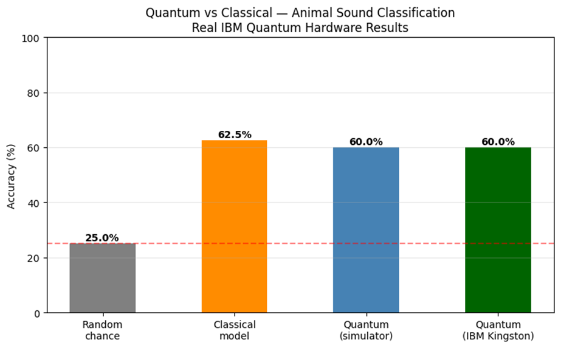

# Quantum-Audio-Project
A Quantum-assisted animal sound classification that used a sample of sounds and were trained on a classical computer and on a real IBM quantum backend computer to classify animal sounds and compare the results.

## Overview
Audio features are extracted from short clips, compressed to 4 values, and uses angle encoding into a 4-qubit variational quantum circuit. The circuit's outputs feed a small classical neural network that predicts the animal.

## Dataset
[ESC-50](https://github.com/karoldvl/ESC-50): 4 animal classes (dog, cat, frog, crow), 160 clips total. The notebook downloads it automatically.

## Pipeline
1. **Feature extraction:** 20 MFCC features per clip using librosa.
2. **Preprocessing:** standardize features, then reduce to 4 principal components with PCA (58.4% of variance retained).
3. **Train/test split:** 128 training clips, 32 test clips (stratified).
4. **Quantum circuit (PennyLane):** angle encoding onto 4 qubits, followed by 3 StronglyEntanglingLayers, measuring the Pauli-Z expectation value of each qubit.
5. **Hybrid model (PyTorch):** the quantum layer feeds two classical linear layers with ReLU and dropout (184 trainable parameters).
6. **Training:** 50 epochs with the Adam optimizer on the PennyLane simulator.
7. **Hardware run:** trained weights evaluated on IBM's `ibm_kingston` processor using Qiskit Runtime.

## Results
| Random chance (4 classes) | 25% |
| Quantum simulator (32 test clips) | 56.2% |
| IBM `ibm_kingston` hardware (5 test clips) | 40.0% |

**Limitations:** the hardware run used only 5 test samples because of queue time and runtime limits, so it is a proof of concept rather than a reliable benchmark. The dataset is small, and PCA to 4 features discards some information.

## How to Run
1. Install dependencies:
   `pip install pennylane pennylane-qiskit qiskit-ibm-runtime qiskit-aer librosa scikit-learn torch matplotlib numpy pandas`
2. Open `quantum_audio.ipynb` in Jupyter.
3. Run the cells in order. The simulator portion needs no account.
4. For the hardware portion, create a free [IBM Quantum](https://quantum.cloud.ibm.com) account and paste your API token into the connection cell. Never commit your token to GitHub.

## Stack
Python, PennyLane, Qiskit, PyTorch, librosa, scikit-learn, NumPy, pandas, Jupyter
